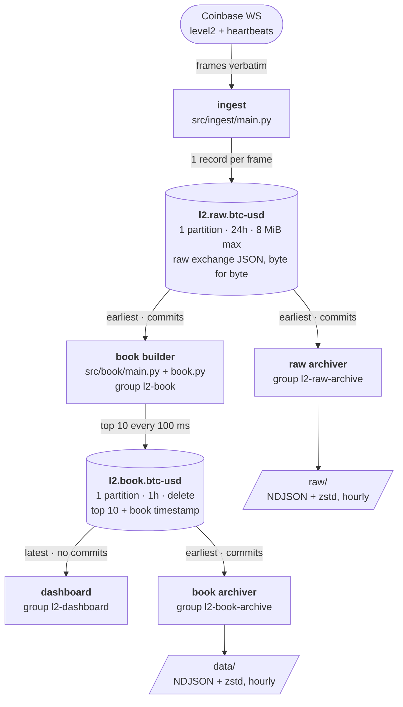

# Architecture

This project ingests the live Coinbase Advanced Trade Level 2 stream for BTC-USD (this symbol only), records every
frame as it arrived, and maintains a verified in-memory copy of the order book from it.

## 1. capture

- role: Hold the websocket connection and record every incoming frame exactly as it arrived,
  before any parsing, together with connect and disconnect markers.
- output: the same frames obtained from WebSocket handed to the buffer.
- guarantee: Arrival timestamps never move backwards. Missed frames and stalled streams are detected, not tolerated — on any doubt the book is discarded and rebuilt from a fresh snapshot.

## 2. buffer

- role: Absorb the firehose between capture and the slower consumers, because the exchange will
  not slow down for us. It is a short-lived queue, not a database.
- output: One ordered stream of raw frames, read independently by each consumer.
- guarantee: A consumer may stop and restart without losing frames.

## 3. decode

- role: Turn raw JSON frames into typed objects at a single boundary, so nothing downstream ever
  touches raw text.
- output: Typed messages — an order-book snapshot, an order-book update — each in an
  envelope carrying the channel, the sequence number.
- guarantee: Malformed input fails here rather than silently corrupting later stages, and prices
  and sizes stay strings end to end.

## 4. book builder

- role: Maintain the live bid and ask book by loading a full snapshot and then applying
  incremental updates; a zero quantity removes a price level.
- output: The current top 10 order book, published every 100 ms, use the most recent frame applied as the timestamp
- guarantee:  Best bid stays below best ask, and sizes are never negative.

## 5. live dashboard

- role: showing the live trading book in terminal with latency and metrics such as bid-ask spread
- output: 10 frames per second, metrics to be decided

## Flow chart

Coinbase WS                                                                                                        
     |                                                                                                              
   ingest                                          
     |                                                                                                              
 l2.raw.btc-usd                                             
     |                                                                                     
     +--> raw archiver                                 
     |                                                                                                              
     +--> book builder                                
     |                                                                                                
     |                                                                                                              
 l2.book.btc-usd                                          
     |                                                                                                              
     +--> dashboard                                
     |                                                                                                              
     +--> book archiver

## out of scope
Storage and validation and query are deliberately not described in this document.

